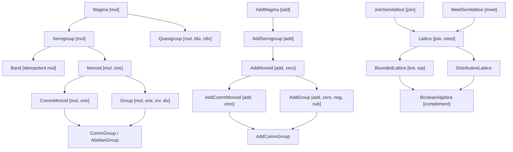

# Granular Algebraic Hierarchy (`algebrax.algebra`)

While a **Semiring** couples addition and multiplication $(\langle S, +, \cdot, \mathbf{0}, \mathbf{1} \rangle)$, many computational domains require only a single operation or an order-theoretic structure:
- **MapReduce & Stream Processing**: Only requires an associative binary operation ($\langle S, \cdot \rangle$, **Semigroup**) and an empty stream identity (**Monoid**).
- **Undo / Reversible Computing & Symmetries**: Requires two-sided inverses ($\langle G, \cdot, \mathbf{1}, ^{-1} \rangle$, **Group**).
- **CRDTs & Access Control**: Requires order-theoretic mergers ($\langle L, \vee, \wedge \rangle$, **Lattice**).
- **Hardware Caching & Routing Tables**: Requires idempotent operations ($a \cdot a = a$, **Band**).

`algebrax.algebra` formalizes these fine-grained structures as `@runtime_checkable` Python protocols with structural subtyping, adhering strictly to Lean 4 Mathlib conventions and AlgebraX's fundamental architectural principle: **the Python dictionary as a raw, unboxed first-class sparse representation**.

---

## The First-Class Sparse Representation Principle

In classical object-oriented libraries, algebraic abstractions often wrap values in boxed objects (`MonoidElement(val)`). In **AlgebraX**, algebraic carrier sets are **purely unboxed native Python types**:

1. **Sparse Vectors as an Additive Abelian Group**:
   A vector $v \in \mathbb{R}^n$ is simply a `dict[str, float]`.
   - The zero element is the empty dictionary `{}`.
   - Addition merges keys and sums non-zero values.
   - Negation maps $k \mapsto -v_k$.
   - **Zero allocation overhead**: No `Vector` or `SparseNode` wrapper classes.

2. **Permutations as a Finite Group**:
   A permutation $\pi \in S_n$ is simply a mapping `dict[K, K]`.
   - Identity is the identity dictionary `{0: 0, 1: 1, 2: 2}`.
   - Multiplication is key-value composition $\pi_1(\pi_2(x))$.
   - Inverse is dictionary key-value inversion $\{v: k\}$.

3. **Lattices as Set Partitions**:
   Carriers are native `frozenset[K]` or bitmasks.
   - Meet is intersection `&`, Join is union `|`.

Algebraic protocols in `algebrax.algebra` act as **stateless typeclass operators**, keeping data representations entirely separate from algorithmic operators.

---

## Mental Models (The Freshman Test)

To make abstract algebra immediately intuitive to software engineers, consider each level through its computational counterpart:

| Structure | Signature | Mental Model | Software Pattern |
| :--- | :--- | :--- | :--- |
| **Magma** | $\langle M, \cdot \rangle$ | **The Mixer** | Any binary combiner taking two items of type $V$ and returning a $V$. |
| **Semigroup** | $\langle S, \cdot \rangle$ | **The Chunk Merger** | Associative parallel reduction; safe for `chunk_reduce` and MapReduce. |
| **Band** | $\langle B, \cdot \rangle$ ($a^2=a$) | **The Idempotent Cache** | Calling the operation twice produces no further change; routing convergence. |
| **Monoid** | $\langle M, \cdot, \mathbf{1} \rangle$ | **The Safe Stream** | Semigroup with a designated empty/default state; safe for empty sequences. |
| **Group** | $\langle G, \cdot, \mathbf{1}, ^{-1} \rangle$ | **The Undo Button** | Monoid with guaranteed reversibility; invertible transformations & symmetries. |
| **Lattice** | $\langle L, \vee, \wedge \rangle$ | **The Dual Reconciliation** | Mutual absorption ($a \wedge (a \vee b) = a$); state sync in distributed CRDTs. |
| **Boolean Algebra** | $\langle B, \vee, \wedge, \neg, \bot, \top \rangle$ | **The Complete Logic** | Complemented distributive lattice; query filters and Boolean SAT. |

---

## The Granular Hierarchy



---

## Dual Multiplicative & Additive Protocols

To mirror standard mathematical notation, `algebrax.algebra` provides explicit multiplicative and additive duals.

### Multiplicative Branch (`mul`, `one`, `inv`, `div`)

```python
from algebrax.algebra import Group, Monoid, Semigroup


class NonZeroFloatGroup:
    """Multiplicative group (R*, *, 1, 1/x)."""

    @property
    def one(self) -> float:
        return 1.0

    def mul(self, a: float, b: float) -> float:
        return a * b

    def inv(self, a: float) -> float:
        return 1.0 / a


grp = NonZeroFloatGroup()
assert isinstance(grp, Group)
assert grp.div(10.0, 2.0) == 5.0
```

### Additive Branch (`add`, `zero`, `neg`, `sub`)

```python
from algebrax.algebra import AddCommGroup


class SparseVectorGroup:
    """Additive group of unboxed sparse vectors dict[str, float]."""

    @property
    def zero(self) -> dict[str, float]:
        return {}

    def add(self, u: dict[str, float], v: dict[str, float]) -> dict[str, float]:
        res = {k: u.get(k, 0.0) + v.get(k, 0.0) for k in set(u) | set(v)}
        return {k: val for k, val in res.items() if val != 0.0}

    def neg(self, u: dict[str, float]) -> dict[str, float]:
        return {k: -val for k, val in u.items()}


svg = SparseVectorGroup()
assert isinstance(svg, AddCommGroup)
u = {'x': 1.0, 'y': 2.0}
v = {'y': 3.0, 'z': -1.0}
assert svg.add(u, v) == {'x': 1.0, 'y': 5.0, 'z': -1.0}
assert svg.sub(u, u) == {}
```

### Domain-Agnostic Single-Operation Branch (`op`, `identity`)

When operations carry no arithmetic bias (e.g. string concatenation, token sequences, bitwise XOR):

```python
from algebrax.algebra import OpCommMonoid, fold_op


class XorMonoid:
    @property
    def identity(self) -> int:
        return 0

    def op(self, a: int, b: int) -> int:
        return a ^ b


xor = XorMonoid()
assert isinstance(xor, OpCommMonoid)
assert fold_op(xor, [1, 2, 4, 1]) == 6
```

---

## AMDS Duality & Seamless Semiring Subtyping

Under the **Algebraic Multi-Paradigm Duality Standard (AMDS)**, `Monoid` uses `mul`/`one` and `AddMonoid` uses `add`/`zero`.

Because `algebrax.semiring.Semiring` defines `.add()`, `.zero`, `.mul()`, and `.one`, **all 34 built-in semirings in AlgebraX automatically satisfy both `AddCommMonoid[V]` and `Monoid[V]` with zero adapter classes or wrapper overhead**:

```python
from algebrax.algebra import AddCommMonoid, Monoid
from algebrax.semiring import StandardSemiring, TropicalSemiring

std = StandardSemiring[float]()
assert isinstance(std, AddCommMonoid)
assert isinstance(std, Monoid)

trop = TropicalSemiring()
assert isinstance(trop, AddCommMonoid)
assert isinstance(trop, Monoid)
```

---

## Order & Lattice Hierarchy

Lattices model partial orders where pairs of elements possess unique least upper bounds (join $\vee$, supremum) and greatest lower bounds (meet $\wedge$, infimum).

```python
from algebrax.algebra import BooleanAlgebra


class PowerSetAlgebra:
    """Power set Boolean algebra over universe U = frozenset({1, 2, 3})."""

    def __init__(self, universe: frozenset[int]) -> None:
        self.universe = universe

    @property
    def bot(self) -> frozenset[int]:
        return frozenset()

    @property
    def top(self) -> frozenset[int]:
        return self.universe

    def join(self, a: frozenset[int], b: frozenset[int]) -> frozenset[int]:
        return a | b

    def meet(self, a: frozenset[int], b: frozenset[int]) -> frozenset[int]:
        return a & b

    def complement(self, a: frozenset[int]) -> frozenset[int]:
        return self.universe - a


ba = PowerSetAlgebra(frozenset({1, 2, 3}))
assert isinstance(ba, BooleanAlgebra)
```

---

## Polymorphic Algebraic Helpers

`algebrax.algebra` provides efficient algorithmic helpers for any conforming typeclass:

- **`power(monoid, a, n)`**: $O(\log n)$ logarithmic binary exponentiation for $n \ge 0$.
- **`zpow(group, a, n)`**: Integer powers for any $n \in \mathbb{Z}$ (computing $a^{-k} = (a^{-1})^k$).
- **`nsum(monoid, a, n)`**: $O(\log n)$ repeated additive doubling for $n \ge 0$.
- **`zsmul(group, a, n)`**: Integer scalar multiplication for any $n \in \mathbb{Z}$.
- **`fold_mul(monoid, items)`**: Fold sequence using `mul`, returning `one` for empty inputs.
- **`fold_add(monoid, items)`**: Fold sequence using `add`, returning `zero` for empty inputs.
- **`fold_op(monoid, items)`**: Fold sequence using domain-agnostic `op`, returning `identity` for empty inputs.

```python
from algebrax.algebra import zpow, zsmul

# Group integer power
assert zpow(grp, 2.0, -3) == 0.125

# Additive group integer scalar multiple on sparse vector
v = {'x': 2.0, 'y': -1.0}
assert zsmul(svg, v, -3) == {'x': -6.0, 'y': 3.0}
```

---

## Verification Engine & Popper Invariant

Every structure in the hierarchy can be formally audited using `algebrax.verification`:

```python
from algebrax.verification import verify_add_comm_group_laws, verify_boolean_algebra_laws

# Audit sparse vector group
res = verify_add_comm_group_laws(svg, [{}, {'x': 1.0}, {'y': 2.0}, {'x': -1.0, 'y': 1.0}])
assert all(res.values())
```

### The Popper Guard Invariant

> **Popper Verification Principle**: An algebraic law cannot be meaningfully confirmed unless tested against sufficient sample diversity.

All law verifiers strictly enforce a minimum sample count $|S| \ge 3$. Passing fewer than 3 samples immediately raises a `ValueError` to prevent false positive passes on trivial singleton or empty sample sets.
