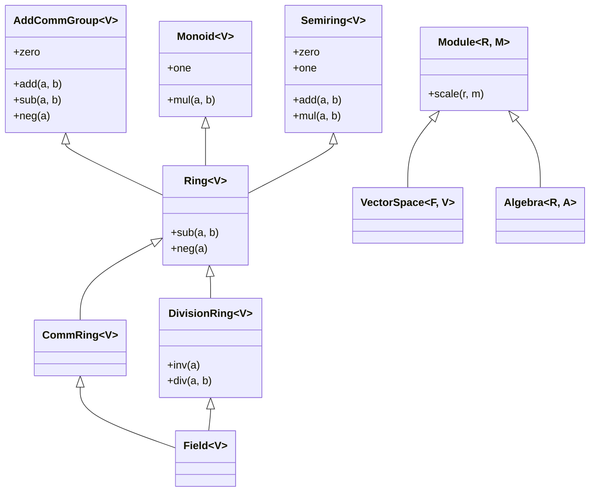

# Rings, Fields, Modules & Exact Matrix Solvers (`algebrax.algebra`)

While semirings $(\langle S, +, \cdot, \mathbf{0}, \mathbf{1} \rangle)$ power path algebras and dynamic programming, scientific computing, exact discrete geometry, cryptography, and modern algebra require:
- **Additive Inverses (Negation & Subtraction)**: $\langle R, +, -, \cdot, \mathbf{0}, \mathbf{1} \rangle$ (**Ring**).
- **Multiplicative Inverses (Division)**: $\langle F, +, -, \cdot, /, \mathbf{0}, \mathbf{1} \rangle$ (**Division Ring & Field**).
- **Two-Sorted Vector Scaling**: Scaling sparse vectors by scalar coefficients (**Semimodule, Module, Vector Space**).
- **Exact Linear Algebra**: Solving linear systems without floating-point roundoff errors over $\mathbb{Q}$ and finite Galois fields $\mathbb{F}_p$.

`algebrax.algebra` formalizes these structures as `@runtime_checkable` Python protocols with structural subtyping, adhering strictly to Lean 4 Mathlib standards and AlgebraX's fundamental architectural principle: **the Python dictionary as a raw, unboxed first-class sparse representation**.

---

## The First-Class Sparse Representation Principle

In AlgebraX, carriers are **purely unboxed native Python types**:

1. **Sparse Vectors as a Free Module / Vector Space**:
   A vector $v \in \mathbb{F}^n$ is a sparse mapping `dict[K, V]` (e.g., `dict[str, Fraction]` or `dict[int, int]`):
   - The zero element is the empty dictionary `{}`.
   - Vector addition merges keys and adds corresponding coordinates.
   - Scalar multiplication scales each present coordinate by scalar $r \in R$.
   - **Zero wrapper allocation**: Algorithms never wrap entries in boxed `VectorEntry` or `MatrixCell` objects.

2. **Sparse Matrices as Linear Operators**:
   A matrix $A$ is represented as a nested dictionary `dict[RowKey, dict[ColKey, V]]`:
   - Exact LU decomposition, matrix inversion, and determinant evaluation execute directly over sparse dictionaries.
   - Polymorphic field typeclasses (`Field[V]`) decouple the matrix carrier from the scalar arithmetic rules.

---

## Mental Models (The Freshman Test)

To make abstract algebraic structures intuitive to software engineers, consider each structure through its computational counterpart:

| Structure | Signature | Mental Model | Software Pattern |
| :--- | :--- | :--- | :--- |
| **Non-Assoc Ring** | $\langle R, +, -, \cdot, \mathbf{0} \rangle$ | **The Curvature Engine** | Additive abelian group with distributive multiplication that need not associate (e.g. Lie brackets, 3D cross products). |
| **Ring** | $\langle R, +, -, \cdot, \mathbf{0}, \mathbf{1} \rangle$ | **The Polynomial Machine** | Both addition and multiplication associate; addition has inverses (negation); multiplication has identity $\mathbf{1}$ (e.g. $\mathbb{Z}$, matrix rings). |
| **Comm Ring** | $\langle R, +, -, \cdot, \mathbf{0}, \mathbf{1} \rangle$ ($ab=ba$) | **The Coordinate Grid** | Ring with commutative multiplication; powers polynomial ideals, exact determinants, and symmetric forms. |
| **Division Ring** | $\langle D, +, -, \cdot, /, \mathbf{0}, \mathbf{1} \rangle$ | **The Non-Commutative Fraction** | Every non-zero element has a multiplicative inverse ($a \cdot a^{-1} = \mathbf{1}$), but multiplication may not commute (e.g. Quaternions $\mathbb{H}$). |
| **Field** | $\langle F, +, -, \cdot, /, \mathbf{0}, \mathbf{1} \rangle$ | **The Exact Calculus** | Commutative division ring; allows full Gaussian elimination, matrix inversion, and exact linear system solving ($\mathbb{Q}, \mathbb{R}, \mathbb{C}, \mathbb{F}_p$). |
| **Module** | $\langle M, +, R, \cdot_s \rangle$ | **The Sparse Vector Space** | Abelian group $M$ coupled with scalar ring $R$; scalar multiplication distributes over both vector and scalar addition. |
| **Vector Space** | $\langle V, +, F, \cdot_s \rangle$ | **The Linear Space** | A module whose scalars form a field $F$; guarantees basis existence, dimensions, and rank-nullity. |
| **Algebra** | $\langle A, +, \cdot, R, \cdot_s \rangle$ | **The Geometric Product** | A vector space equipped with a bilinear vector-vector product (e.g. Clifford algebras, Lie algebras). |

---

## Hierarchy Architecture

The following diagram illustrates how rings, fields, modules, and algebras compose the granular hierarchy:



---

## Concrete Field Implementations

AlgebraX provides concrete, zero-overhead field implementations:

### 1. `StandardField[V]`
Wraps standard Python numeric types (`float`, `fractions.Fraction`, `complex`):

```python
from fractions import Fraction
from algebrax.algebra import StandardField

# Exact rational field
field_q = StandardField(Fraction)

a = Fraction(1, 3)
b = Fraction(1, 6)

print(field_q.add(a, b))  # Fraction(1, 2)
print(field_q.div(a, b))  # Fraction(2, 1)
print(field_q.inv(a))     # Fraction(3, 1)
```

### 2. `ModularField` (Galois Field $\mathbb{F}_p$)
Implements arithmetic over prime fields using modular inverse via extended Euclidean algorithm:

```python
from algebrax.algebra import ModularField

# Finite field modulo 7
f7 = ModularField(7)

# In F_7: 3 * 5 = 15 = 1 (mod 7) => inv(3) == 5
print(f7.inv(3))          # 5
print(f7.div(4, 3))       # 6  (4 * 5 = 20 = 6 mod 7)
print(f7.neg(2))          # 5  (7 - 2 = 5 mod 7)
```

---

## Exact Matrix Solvers

Classical floating-point linear algebra suffers from catastrophic cancellation on ill-conditioned systems. AlgebraX's matrix routines support an optional `field: Field[V]` parameter, executing exact Gaussian elimination on native sparse dictionaries.

### Solving Ill-Conditioned Hilbert Systems

The Hilbert matrix $H_{i,j} = \frac{1}{i + j + 1}$ is notoriously ill-conditioned. Over `float64`, standard algorithms lose all precision for modest $N$. Over `StandardField(Fraction)`, solutions are mathematically exact:

```python
from fractions import Fraction
from algebrax.algebra import StandardField
from algebrax.matrix import lu_decompose, solve, det, inv

# 2x2 Hilbert Matrix
h2 = {
    0: {0: Fraction(1, 1), 1: Fraction(1, 2)},
    1: {0: Fraction(1, 2), 1: Fraction(1, 3)},
}
q = StandardField(Fraction)

# Exact determinant: det(H_2) = (1)(1/3) - (1/2)(1/2) = 1/12
print(det(h2, field=q))  # Fraction(1, 12)

# Exact inverse
inv_h = inv(h2, field=q)
# inv_h == {0: {0: Fraction(4, 1), 1: Fraction(-6, 1)}, 1: {0: Fraction(-6, 1), 1: Fraction(12, 1)}}

# Exact linear solve: H_2 x = b
b = {0: Fraction(1, 1), 1: Fraction(0, 1)}
x = solve(h2, b, field=q)
print(x)  # {0: Fraction(4, 1), 1: Fraction(-6, 1)}
```

### Cryptographic Systems Over $\mathbb{F}_p$

Linear equations over finite fields arise in Reed-Solomon coding, cryptography, and network coding:

```python
from algebrax.algebra import ModularField
from algebrax.matrix import solve

# System modulo 11:
# 3x + 2y = 5 (mod 11)
# 4x + 9y = 1 (mod 11)
a = {
    'eq1': {'x': 3, 'y': 2},
    'eq2': {'x': 4, 'y': 9},
}
b = {'eq1': 5, 'eq2': 1}
f11 = ModularField(11)

sol = solve(a, b, field=f11)
print(sol)  # Exact integer coordinates in F_11
```

---

## Performance Engineering (The Shannon Principle)

AlgebraX implements two critical performance optimizations in sparse LU factorization:

1. **Pivot Inversion Hoisting**:
   In any field, division is substantially more expensive than multiplication (e.g. modular inverse via extended Euclidean algorithm or rational gcd reductions). The elimination step computes:
   $$\text{inv\_pivot} = \text{inv}(\text{pivot})$$
   once per outer step, transforming $O(N)$ row-divisions into $O(N)$ multiplications.

2. **Inner Zero-Skipping**:
   Before updating $w_{i,j} \leftarrow w_{i,j} - \text{factor} \cdot w_{k,j}$, the algorithm inspects both $\text{factor}$ and $w_{k,j}$. If either coordinate is zero in the field, the entire column inner loop is skipped, preserving sparsity.

---

## Law Verification Engine

AlgebraX includes property-based law verifiers in `algebrax.verification`:

```python
from algebrax.verification import (
    verify_comm_ring_laws,
    verify_field_laws,
    verify_module_laws,
)

# Verify ring axioms
samples_q = [Fraction(0, 1), Fraction(1, 1), Fraction(-2, 3), Fraction(5, 4)]
q_field = StandardField(Fraction)

results = verify_field_laws(q_field, samples_q)
assert all(results.values())
# Checks:
# - additive_associativity, additive_identity, additive_inverse, additive_commutativity
# - multiplicative_associativity, multiplicative_identity, multiplicative_commutativity
# - left_distributivity, right_distributivity
# - multiplicative_inverse, zero_division_guard
```

### The Zero-Division Contract (Golem Rule)

In accordance with strict safety invariants, all `DivisionRing` and `Field` implementations enforce that division by zero or inversion of zero raises `ZeroDivisionError`:

```python
try:
    field_q.inv(Fraction(0, 1))
except ZeroDivisionError:
    print("Caught division by zero!")
```
