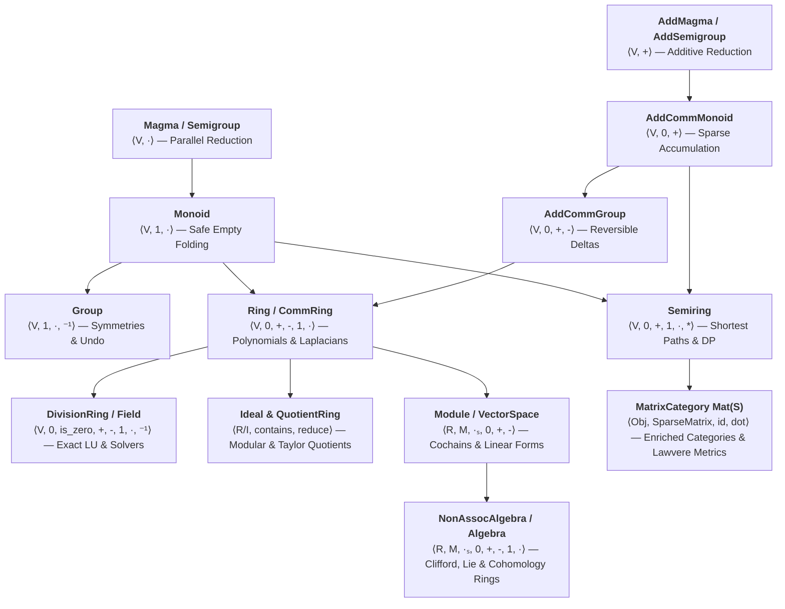

# User Guide Overview

Welcome to the **AlgebraX User Guide**. AlgebraX is organized deductively along the **Pure Algebraic Hierarchy** — starting from single-operation building blocks (`Magma`, `Monoid`, `Group`) and ascending through two-operation systems (`Lattice`, `Semiring`), additive inverses (`Ring`, `Field`), two-sorted linear actions (`Module`, `VectorSpace`, `Algebra`), and topological complexes (`Homology`, `Cohomology`, `DEC`, `CellularSheaf`).

---

## 1. The Axiom Staircase

Every step up the algebraic staircase adds a single operational mixin (`Has*`) and unlocks a new class of computational algorithms:

---

## 2. The Hacker's Translation Box (Jargon Decoder)

Abstract mathematical vocabulary exists to tell you **what operations are legal** and **what optimizations are safe**:

| Mathematical Term | Atomic Mixin Composition                                                              | Concrete Analogy                                                          | Computational Superpower                                                                    |
|:------------------|:--------------------------------------------------------------------------------------|:--------------------------------------------------------------------------|:--------------------------------------------------------------------------------------------|
| **Magma**         | `(HasMul[V])`                                                                         | Mixing paints: `mix(red, blue) -> purple`.                                | Basic closure: combining two items of type $V$ into a $V$.                                  |
| **Semigroup**     | `(HasMul[V])`                                                                         | String concatenation: `("a"+"b")+"c" == "a"+("b"+"c")`.                   | **Parallel computing!** Splitting and reducing across CPU cores (`MapReduce`).              |
| **Monoid**        | `(HasOne[V], HasMul[V])`                                                              | Adding $0$, multiplying by $1$, empty string `""`.                        | Safe reduction over empty streams (`fold_mul`) without `if len == 0:` guards.               |
| **Group**         | `(HasOne[V], HasMul[V], HasInv[V])`                                                   | Permutation shuffles, Git revert patches, 3D rotations.                   | **Guaranteed undo!** Every transformation has an exact inverse $a^{-1}$.                    |
| **Lattice**       | `(HasJoin[V], HasMeet[V])`                                                            | Set union $\cup$ and intersection $\cap$, `max` and `min`.                | **Conflict-free state merging** (CRDTs, access-control security clearances).                |
| **Semiring**      | `(HasZero[V], HasAdd[V], HasOne[V], HasMul[V])`                                       | Matrix multiplication with custom $(\oplus, \otimes)$ aggregators.       | **Polymorphic algebra!** Pure rig foundations; every Ring is a Semiring.                   |
| **StarSemiring**  | `(HasZero[V], HasAdd[V], HasOne[V], HasMul[V], HasStar[V])`                           | Path aggregation with Kleene closure $a^* = \mathbf{1} + a a^*$.         | **Transitive paths & series!** (Taylor derivatives, infinite reachability, Conway rigs).  |
| **KleeneAlgebra** | `(HasZero[V], HasAdd[V], HasOne[V], HasMul[V], HasStar[V], LawIdempotent)`           | Idempotent star semiring ($a \oplus a = a$) such as Tropical $(\min, +)$. | **Extremal path finding & automata!** (Bellman-Ford, Viterbi, regex matching).             |
| **Ring**          | `(HasZero[V], HasAdd[V], HasNeg[V], HasOne[V], HasMul[V])`                            | Integers $\mathbb{Z}$, polynomials $R[x]$, graph Laplacians $L = D - W$.  | **Cancellation!** Subtracting terms ($a - b$) enables error codes and wave diffusion.       |
| **Ideal**         | `(HasContains[V], HasReduce[V])`                                                      | Multiples of $n$ ($n\mathbb{Z}$), high-degree Taylor tail $(x^k)$.        | **Canonical quotienting!** Zero-overhead modular arithmetic $R/I$ via `ideal.reduce(x)`.    |
| **Field**         | `(HasZero[V], HasZeroPred[V], HasAdd[V], HasNeg[V], HasOne[V], HasMul[V], HasInv[V])` | Rationals $\mathbb{Q}$, reals $\mathbb{R}$, finite fields $\mathbb{F}_p$. | **Exact Linear Algebra!** Gaussian elimination, LU, determinant, inverse, and linear systems with zero drift. |
| **Module**        | `(HasScale[R, M], HasZero[M], HasAdd[M], HasNeg[M])`                                  | Sparse vectors scaled by integers or polynomials.                         | Discrete differential forms, simplicial chains $C_k(K; R)$, integer lattices.               |
| **Algebra**       | `(HasScale[R, M], HasZero[M], HasAdd[M], HasNeg[M], HasOne[M], HasMul[M])`            | Vectors that can also be multiplied together (rotors, Lie brackets).      | **3D/4D physics**, rigid-body kinematics ($\mathfrak{so}(3)$), Dirac spinors, cup products. |
| **Category**      | `Category[Obj, Mor]` / `MatrixCategory[K, V]`                                         | Directed graphs where paths compose by matrix multiplication `dot(f, g)`. | **Functorial duality & Lawvere metrics** ($\mathbf{Mat}(\mathcal{S})^{\mathrm{op}} \cong \mathbf{Mat}(\mathcal{S})$ via transpose). |

---

## 3. Fast-Track Elevators by Discipline

Jump directly to the guide matching your engineering domain:

- 🚀 **The Graph & Network Engineer**: Jump straight to [Semirings & Optimization](semirings/optimization.md) for shortest paths, widest bottleneck capacity, and transitive closures, or [Spectral Graph Theory](transforms/spectral.md) for Laplacians and Fiedler cuts.
- 🎯 **The Exact Math & Crypto Solver**: Jump straight to [Exact Matrix Solvers](algebra/exact_matrix_solvers.md) and [Rings & Fields](algebra/rings_and_fields.md) for drift-free rational LU, determinants, matrix inverse, and Galois field $\operatorname{GF}(p^m)$ arithmetic.

- 🛰️ **The Robotics, 3D & Physics Engineer**: Jump straight to [Clifford Geometric Algebra](algebra/clifford_geometric_algebra.md) and [Lie Algebras](algebra/lie_algebras.md) for gimbal-lock-free rotor rotations and Baker–Campbell–Hausdorff (BCH) dynamics.
- 🌐 **The Data & Shape Explorer**: Jump straight to [Simplicial Homology](topology/homology.md), [Cohomology Rings](topology/cohomology.md), and [Discrete Exterior Calculus](topology/dec.md) for persistent barcodes, Hodge star operators, and Helmholtz–Hodge flow decomposition.

---

## 4. Quick Tour of the 7 Guide Tiers

1. **[Single-Operation Structures](algebra/magmas_and_monoids.md)**: Atomic operational mixins (`Has*`), magmas, semigroups, bands, monoids, and [groups & permutation symmetries](algebra/groups_and_symmetries.md).
2. **[Two-Operation Systems](algebra/lattices_and_order.md)**: Order-theoretic [lattices & Boolean algebras](algebra/lattices_and_order.md) and the [34 built-in semirings](semirings/index.md).
3. **[Additive Inverses (Rings, Ideals & Fields)](algebra/rings_and_fields.md)**: [Rings and fields](algebra/rings_and_fields.md), [homomorphisms, ideals, canonical quotients & polynomials](algebra/polynomials_and_quotients.md), and [exact sparse matrix solvers](algebra/exact_matrix_solvers.md).
4. **[Two-Sorted Systems (Modules, Algebras & Tensors)](algebra/modules_and_vector_spaces.md)**: [Semimodules, modules & vector spaces](algebra/modules_and_vector_spaces.md), [Clifford geometric algebras](algebra/clifford_geometric_algebra.md), [Lie algebras](algebra/lie_algebras.md), and sparse [tensors & einsum](tensor/einsum.md).
5. **[Discrete Geometry & Topology](topology/homology.md)**: Simplicial homology, graded cohomology rings, persistent homology barcodes, Discrete Exterior Calculus (DEC), and cellular sheaves.
6. **[Categories, Automata & Dynamics](discrete/category.md)**: Matrix categories $\mathbf{Mat}(\mathcal{S})$, Lawvere metric spaces, Kleisli composition, weighted finite automata, information theory, spectral graph theory, and discrete graph calculus.
7. **[Ecosystem Bridges & Decompositions](matrix/decompositions.md)**: Matrix decompositions (LU, QR, SVD, Cholesky), CodSpeed micro-benchmarks, and academic reference operators.

