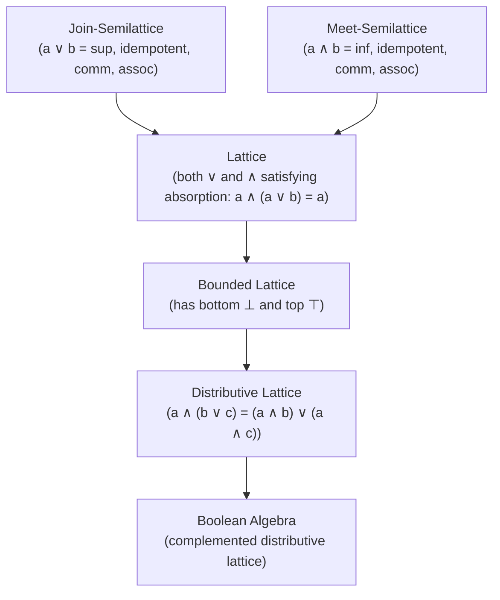
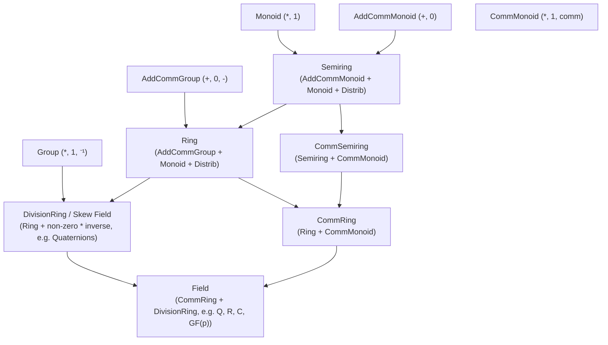

# EXP-0004: The Pure Algebraic Hierarchy — From Magmas to Division Algebras & Modules (Lean 4 Mathlib Alignment)

| Field           | Value                                                                                                                                                                                                                                                                                                         |
|:----------------|:--------------------------------------------------------------------------------------------------------------------------------------------------------------------------------------------------------------------------------------------------------------------------------------------------------------|
| **EXP**         | 0004                                                                                                                                                                                                                                                                                                          |
| **Title**       | The Pure Algebraic Hierarchy — From Magmas to Division Algebras & Modules (Lean 4 Mathlib Alignment)                                                                                                                                                                                                          |
| **Author**      | Eran Rivlis & Antigravity                                                                                                                                                                                                                                                                                     |
| **Status**      | Active                                                                                                                                                                                                                                                                                                        |
| **Type**        | Architectural & Theoretical Exploration                                                                                                                                                                                                                                                                       |
| **Created**     | 2026-10-25                                                                                                                                                                                                                                                                                                    |
| **Updated**     | 2026-10-25                                                                                                                                                                                                                                                                                                    |
| **Related EPs** | [EP-0100](../../docs/proposals/EP-0100-quotient-monoid-algebra.md), [EP-0131](../../docs/proposals/EP-0131-algebraic-law-verification.md), [EP-0134](../../docs/proposals/EP-0134-semiring-namespace-refactoring.md), [EP-0185](../../docs/proposals/EP-0185-axiomatic-statistical-sheaf-mms-verification.md) |

---

## 1. Abstract & Context

Since its inception, `algebrax` has centered its algebraic abstraction around the **`Semiring`**
protocol $(S, \oplus, \otimes, \mathbf{0}, \mathbf{1})$. This design choice was deliberate: a semiring is the minimal
structure required to define matrix multiplication $C_{ik} = \bigoplus_j A_{ij} \otimes B_{jk}$, enabling polymorphic
execution of linear algebra, shortest-path optimization (tropical), and symbolic provenance tracking on the exact same
sparse dictionary carrier.

However, treating `Semiring` as the foundational primitive introduces two distinct structural limitations:

1. **Sub-Semiring Deficits (Structures Simpler than Semirings)**:
    - A sequence of path concatenations in a graph requires only a **Monoid** $(M, \cdot, 1)$, yet currently must be
      embedded artificially into a semiring with a dummy addition.
    - Idempotent reachability or transitive closure requires only a **Semilattice** or **Band** $(\vee)$ or
      **Lattice** $(\wedge, \vee)$, not a full multiplication.
    - Reversible transformations, permutations, and symmetries form a **Group** $(G, \cdot, ^{-1}, 1)$, yet have no
      natural representation in a pure semiring without either ignoring addition or introducing additive inverses.
    - Non-associative structures (e.g., octonions, sedenions, loop quasigroups) are **Magmas**
      where $(a \cdot b) \cdot c \ne a \cdot (b \cdot c)$.

2. **Super-Semiring Deficits (Structures Richer than Semirings)**:
    - Linear equation solving ($A x = b$), Gaussian elimination, LU/QR/Cholesky decompositions, and determinant
      calculations mathematically require **additive inverses** ($\text{neg}$, $-$) and **multiplicative inverses**
      ($/$, $^{-1}$), i.e., **Rings**, **Division Rings** (Skew Fields), and **Fields**. Currently, `algebrax` assumes
      floating-point primitives for these operations rather than dispatching on a formal `Field[V]` protocol.
    - Scalar-vector interactions ($c \cdot \mathbf{v}$) and matrix-vector operations are instances of **Modules** over a
      ring or **Semimodules** over a semiring. Currently, vector scalar scaling is tightly coupled to concrete numeric
      types rather than an abstract scalar action $\cdot: R \times M \to M$.

This exploration investigates how to decompose and extend `algebrax` into a **pure, granular algebraic hierarchy**
inspired by the state-of-the-art typeclass hierarchy in **Lean 4 (`Mathlib.Algebra`)**, while remaining 100% Pythonic,
zero-overhead, and fully backwards-compatible with existing `Semiring` code.

---

## 2. Theoretical Foundations: The Lean 4 / Mathlib Algebraic Hierarchy

In Lean 4's `Mathlib`, algebraic structures are not monoliths. They are factored into atomic single-operation
typeclasses that compose via multiple inheritance and mixins.

### 2.1 The Single-Operation Axis (Additive & Multiplicative)

Mathematical structures with a single closed binary operation $\star: S \times S \to S$ form an ascending hierarchy of
axioms:

```mermaid
flowchart TD
    subgraph Multiplicative ["Multiplicative Structures (*, 1, inv)"]
        M_Magma["Magma\n(closed binary op *)"]
        M_Semigroup["Semigroup\n(associativity: a*(b*c) = (a*b)*c)"]
        M_Monoid["Monoid\n(identity: 1*a = a*1 = a)"]
        M_Group["Group\n(inverses: a * a⁻¹ = 1)"]
        M_CommGroup["CommGroup / AbelianGroup\n(commutativity: a*b = b*a)"]
        M_Magma --> M_Semigroup
        M_Semigroup --> M_Monoid
        M_Monoid --> M_Group
        M_Group --> M_CommGroup
    end

    subgraph Additive ["Additive Structures (+, 0, neg)"]
        A_AddMagma["AddMagma\n(closed binary op +)"]
        A_AddSemigroup["AddSemigroup\n(associativity: a+(b+c) = (a+b)+c)"]
        A_AddMonoid["AddMonoid\n(identity: 0+a = a+0 = a)"]
        A_AddGroup["AddGroup\n(negation: a + (-a) = 0)"]
        A_AddCommGroup["AddCommGroup\n(commutativity: a+b = b+a)"]
        A_AddMagma --> A_AddSemigroup
        A_AddSemigroup --> A_AddMonoid
        A_AddMonoid --> A_AddGroup
        A_AddGroup --> A_AddCommGroup
    end
```



### 2.2 Order & Idempotent Structures (Lattices)

Structures governed by partial orders $\le$ and idempotent operations ($a \star a = a$):



*Note*: In `algebrax`, `BooleanSemiring` is currently an instance of a bounded distributive lattice with $\oplus = \vee$
and $\otimes = \wedge$.

### 2.3 Two-Operation Structures: Semirings, Rings, and Fields

When an additive structure and a multiplicative structure are coupled via the **distributive laws**:
$$a \otimes (b \oplus c) = (a \otimes b) \oplus (a \otimes c), \qquad (a \oplus b) \otimes c = (a \otimes c) \oplus (b \otimes c)$$
and **zero annihilation**:
$$a \otimes \mathbf{0} = \mathbf{0} \otimes a = \mathbf{0}$$

We obtain the two-operation hierarchy:



### 2.4 Two-Sorted Structures: Actions, Modules, and Algebras

In advanced linear algebra and representation theory, operations occur between elements of two different sets: a
**scalar ring** $R$ and a **carrier space** $M$:

1. **Scalar Action (`SMul[R, M]`)**:
   A map $\cdot: R \times M \to M$ such that $1 \cdot m = m$ and $(r \cdot s) \cdot m = r \cdot (s \cdot m)$.
2. **Semimodule (`Semimodule[S, M]`)**:
   An additive commutative monoid $M$ with an action by a semiring $S$ that distributes over both additions:
   $$r \cdot (m_1 \oplus m_2) = (r \cdot m_1) \oplus (r \cdot m_2), \qquad (r_1 \oplus r_2) \cdot m = (r_1 \cdot m) \oplus (r_2 \cdot m)$$
3. **Module (`Module[R, M]`)**:
   An additive abelian group $M$ over a ring $R$.
4. **Vector Space (`VectorSpace[F, V]`)**:
   A module over a field $F$.
5. **Algebra (`Algebra[R, A]`)**:
   A ring $A$ that is simultaneously an $R$-module such that scalar multiplication associates with ring multiplication:
   $$r \cdot (a \cdot b) = (r \cdot a) \cdot b = a \cdot (r \cdot b)$$

---

## 3. Comparison of Algebraic Type Systems

| Feature / Dimension     | Lean 4 (Mathlib)                         | Haskell (`algebra`, `numeric-prelude`)       | Rust (`alga`, `num-traits`)     | Current `algebrax`                 | Proposed `algebrax.algebra`                        |
|:------------------------|:-----------------------------------------|:---------------------------------------------|:--------------------------------|:-----------------------------------|:---------------------------------------------------|
| **Underlying Metaphor** | Typeclasses with mixins                  | Typeclasses (`class Magma a => Semigroup a`) | Traits with supertraits         | Monolithic `Protocol` (`Semiring`) | Composable Protocols (`typing.Protocol`)           |
| **Atomic Operation**    | `HMul`, `HAdd`, `Mul`, `Add`             | `Semigroup (<>)`                             | `AbstractMagma`                 | Bundled `add` & `mul`              | `Magma` / `AddMagma` protocols                     |
| **Inverses**            | Separate `Neg`, `Inv`, `Sub`, `Div`      | `Group`, `Ring`, `Field`                     | `Invertible`, `TwoSidedInverse` | Implicit in Python floats          | Explicit `Group`, `Ring`, `Field` protocols        |
| **Scalar Actions**      | `SMul R M`, `Module R M`                 | `Module r m`                                 | `Module<Ring = R>`              | Implicit in `vec_scale`            | First-class `Semimodule[R, M]`, `Module[R, M]`     |
| **Axiom Verification**  | Formal interactive theorem proving (ITP) | QuickCheck / Tasty law testing               | `approx` / property tests       | `algebrax.verification` PBT        | Layered axiomatic verification per typeclass       |
| **Runtime Overhead**    | 0 (erased at compile time)               | 0 (dictionary passing / inlined)             | 0 (zero-cost trait dispatch)    | Zero (plain function calls)        | Zero (Python Protocols check structural subtyping) |

---

## 4. Architectural Design for AlgebraX

### 4.1 Guiding Principles (The Council Alignment)

1. **100% Backwards Compatibility (The Steward Pillar)**:
   Existing code using `from algebrax.semiring import StandardSemiring` or `algebrax.matrix.dot(..., semiring=...)` MUST
   continue working without a single modification. `Semiring` simply becomes a composite protocol in the new hierarchy.
2. **Structural Subtyping via `typing.Protocol` (The Golem Pillar)**:
   Users do NOT need to inherit from base classes unless they want default method implementations. Any class
   implementing `.add()` and `.zero` is automatically an `AddMonoid`.
3. **Algorithmic Specialization (The Shannon Pillar)**:
   Algorithms specify their minimal requirement. For example:
    - `algebrax.matrix.vector_sum` requires only `AddCommMonoid[V]`.
    - `algebrax.matrix.solve_triangular` requires `Field[V]` (or `DivisionRing[V]`) for division.
    - `algebrax.automata.word_concatenation` requires only `Monoid[V]`.
4. **Layered Falsifiability (The Popper Pillar)**:
   Every protocol in the hierarchy has a corresponding law validator in `algebrax.verification`:
    - `verify_magma(instance, samples)`
    - `verify_semigroup(instance, samples)`
    - `verify_monoid(instance, samples)`
    - `verify_group(instance, samples)`
    - `verify_ring(instance, samples)`
    - `verify_field(instance, samples)`

### 4.2 Proposed Directory and Module Structure

```text
src/algebrax/
├── algebra/                    # New: Granular algebraic hierarchy
│   ├── __init__.py             # Re-exports all protocols and base mixins
│   ├── _magma.py               # Magma, Semigroup, Band, Quasigroup
│   ├── _monoid.py              # Monoid, CommutativeMonoid, FreeMonoid
│   ├── _group.py               # Group, AbelianGroup, PermutationGroup
│   ├── _lattice.py             # Semilattice, Lattice, BoundedLattice, BooleanAlgebra
│   ├── _ring.py                # NonUnitalRing, Ring, CommutativeRing, IntegralDomain
│   ├── _field.py               # DivisionRing (SkewField), Field
│   ├── _module.py              # Action (SMul), Semimodule, Module, VectorSpace, Algebra
│   └── _helpers.py             # Default binary exponentiation, inversion solvers
├── semiring/                   # Existing: Preserved and re-rooted in the hierarchy
│   ├── _base.py                # Semiring protocol: class Semiring(AddCommMonoid[V], Monoid[V], Protocol[V])
│   └── ...
└── verification/               # Extended with layered law checkers
    ├── hierarchy.py            # Layered property-based law verification per algebraic typeclass
    └── ...
```

### 4.3 Python Protocol Signatures

#### Single-Operation Protocols (`src/algebrax/algebra/_magma.py`, `_monoid.py`, `_group.py`)

```python
from typing import Protocol, TypeVar, runtime_checkable

V = TypeVar('V')


@runtime_checkable
class Magma(Protocol[V]):
    """A set equipped with a single closed binary operation: S x S -> S."""

    def op(self, a: V, b: V) -> V: ...


@runtime_checkable
class Semigroup(Magma[V], Protocol[V]):
    """An associative magma: op(op(a, b), c) == op(a, op(b, c))."""
    ...


@runtime_checkable
class Monoid(Semigroup[V], Protocol[V]):
    """A semigroup equipped with a neutral identity element."""

    @property
    def id(self) -> V: ...


@runtime_checkable
class CommutativeMonoid(Monoid[V], Protocol[V]):
    """A monoid whose operation is commutative: op(a, b) == op(b, a)."""
    ...


@runtime_checkable
class Group(Monoid[V], Protocol[V]):
    """A monoid where every element possesses a two-sided inverse."""

    def inv(self, a: V) -> V: ...


@runtime_checkable
class AbelianGroup(Group[V], CommutativeMonoid[V], Protocol[V]):
    """A commutative group."""
    ...
```

#### Additive vs Multiplicative Dual Protocols

To mirror standard mathematical notation ($+$ vs $\times$):

```python
@runtime_checkable
class AddMonoid(Protocol[V]):
    @property
    def zero(self) -> V: ...

    def add(self, a: V, b: V) -> V: ...


@runtime_checkable
class AddCommMonoid(AddMonoid[V], Protocol[V]):
    ...


@runtime_checkable
class AddGroup(AddMonoid[V], Protocol[V]):
    def neg(self, a: V) -> V: ...

    def sub(self, a: V, b: V) -> V: ...


@runtime_checkable
class AddCommGroup(AddGroup[V], AddCommMonoid[V], Protocol[V]):
    ...
```

#### Re-rooting `Semiring` into the Hierarchy

```python
@runtime_checkable
class Semiring(AddCommMonoid[V], Protocol[V]):
    """A mathematical Semiring (S, +, *, 0, 1)."""

    @property
    def one(self) -> V: ...

    def mul(self, a: V, b: V) -> V: ...

    def power(self, a: V, n: int) -> V: ...

    def star(self, a: V) -> V: ...
```

#### Super-Semiring Protocols: `Ring` and `Field`

```python
@runtime_checkable
class Ring(Semiring[V], AddCommGroup[V], Protocol[V]):
    """A ring is a semiring whose additive monoid is an Abelian Group."""

    def neg(self, a: V) -> V: ...

    def sub(self, a: V, b: V) -> V: ...


@runtime_checkable
class CommutativeRing(Ring[V], Protocol[V]):
    """A ring with commutative multiplication: mul(a, b) == mul(b, a)."""
    ...


@runtime_checkable
class DivisionRing(Ring[V], Protocol[V]):
    """A non-zero ring where every non-zero element has a multiplicative inverse."""

    def inv(self, a: V) -> V: ...

    def div(self, a: V, b: V) -> V: ...


@runtime_checkable
class Field(DivisionRing[V], CommutativeRing[V], Protocol[V]):
    """A commutative division ring (e.g. Q, R, C, GF(p))."""
    ...
```

#### Two-Sorted Protocols: Actions, Modules, and Vector Spaces

```python
R = TypeVar('R')
M = TypeVar('M')


@runtime_checkable
class Semimodule(Protocol[R, M]):
    """A commutative additive monoid M with scalar multiplication by semiring R."""

    def smul(self, r: R, m: M) -> M: ...


@runtime_checkable
class Module(Semimodule[R, M], Protocol[R, M]):
    """An abelian group M with scalar multiplication by ring R."""
    ...


@runtime_checkable
class VectorSpace(Module[R, M], Protocol[R, M]):
    """A module over a field R."""
    ...
```

---

## 5. Concrete Algorithmic Specialization in AlgebraX

How would existing algorithms benefit from this fine-grained hierarchy?

### 5.1 Matrix Multiplication: Minimum Requirements

- **Standard Matrix Multiplication** ($A \times B$): Requires `Semiring[V]` (needs `add`, `mul`, `zero`).
- **Tropical Shortest Path**: Requires only an **Ordered Monoid** $(\mathbb{R} \cup \{\infty\}, +, 0, \le)$ or
  `TropicalSemiring`.
- **Boolean Reachability / Transitive Closure**: Requires only a **Bounded Distributive
  Lattice** $(\{0, 1\}, \vee, \wedge, 0, 1)$ or `BooleanSemiring`.

### 5.2 Exact Linear Solvers & Decompositions (`algebrax.matrix.decompose`)

- **Sparse LU Decomposition (`lu_decompose`)**:
  Currently assumes Python `float` division `/`. *With `Field[V]`*: Works generically over **exact rational numbers**
  (`Field[Fraction]`), **Galois finite fields** (`Field[GF(p)]`), or **modular arithmetic** without any code
  duplication.
- **Matrix Inversion (`inv`)**:
  Requires `DivisionRing[V]` (works over quaternions and non-commutative division rings).
- **Determinants (`det`)**:
  Requires `CommutativeRing[V]` via Leibniz permutation formula or Bareiss fraction-free algorithm.

### 5.3 Formal Verification

In `algebrax.verification`:

```python
from algebrax.algebra import Field, Group, Ring, Semiring
from algebrax.verification import verify_field_laws, verify_group_laws, verify_ring_laws

# Validating StandardSemiring(Fraction)
q_field = StandardSemiring(Fraction)
assert isinstance(q_field, Field)
verify_field_laws(q_field, sample_values=[Fraction(1, 2), Fraction(-3, 4), Fraction(5, 7)])
```

---

## 6. The Verdict & Actionable Roadmap

### 6.1 Exploration Verdict: Highly Recommended (Green Light)

The Council and architectural review find this expansion:

1. **Mathematically Sound**: Aligns AlgebraX directly with modern constructive algebra (Lean 4 Mathlib, Bourbaki).
2. **Zero Breaking Changes**: Existing `Semiring` code remains completely untouched and 100% functional.
3. **Zero Runtime Overhead**: Uses Python `typing.Protocol` with optional `@runtime_checkable`, which costs zero cycles
   during hot numerical loops.
4. **Significant Generalization**: Unlocks exact finite field linear algebra, exact rational matrix decompositions,
   abstract groups/lattices, and clean module scalar actions.

### 6.2 Recommended Implementation Phasing (New Standards Track)

We can structure this into two targeted Enhancement Proposals:

- **`EP-0190: Granular Algebraic Hierarchy — Magmas, Monoids, Groups & Lattices`**:
    - Implements `algebrax.algebra` with single-operation and order-based protocols (`Magma`, `Semigroup`, `Monoid`,
      `Group`, `CommGroup`, `JoinSemilattice`, `MeetSemilattice`, `Lattice`, `BooleanAlgebra`).
    - Layered property-based law verification in `algebrax.verification`.
    - Specializes graph path accumulation and reachability to minimal algebraic signatures over native sparse dictionaries.

- **`EP-0191: Rings, Fields, Modules & Exact Matrix Solvers`**:
    - Implements two-operation and two-sorted protocols (`Ring`, `CommutativeRing`, `DivisionRing`, `Field`,
      `Semimodule`, `Module`, `VectorSpace`, `Algebra`).
    - Re-roots `Semiring` seamlessly in `algebrax.algebra._semiring` as a sub-protocol of `AddCommMonoid` and `Monoid`.
    - Refactors `algebrax.matrix.decompose` and linear solvers to accept `Field[V]` and `DivisionRing[V]` for exact
      rational and Galois field Gaussian elimination, executing directly on sparse dictionary carriers.

---

## 7. Artifacts & Source References

1. **Lean 4 Mathlib Hierarchy**:
    - `Mathlib.Algebra.Group.Defs`: `Magma`, `Semigroup`, `Monoid`, `Group`, `CommGroup`.
    - `Mathlib.Algebra.Ring.Defs`: `Distrib`, `NonUnitalNonAssocSemiring`, `Semiring`, `Ring`, `CommRing`.
    - `Mathlib.Algebra.Field.Defs`: `DivisionRing`, `Field`.
    - `Mathlib.Algebra.Module.Defs`: `SMul`, `Module`, `Algebra`.
2. **Standard References**:
    - Bourbaki, N. *Algebra I: Chapters 1–3*. Springer.
    - Mac Lane, S. *Categories for the Working Mathematician*. Springer.
    - Golan, J. S. *Semirings and their Applications*. Springer.
