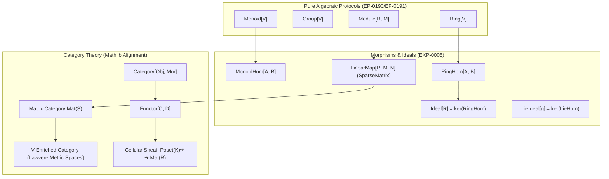

# EXP-0005: Categorical Foundations, Enriched Matrices & Algebraic Morphisms (Lean 4 Mathlib Alignment)

| Field           | Value                                                                                                                                                                                            |
|:----------------|:-------------------------------------------------------------------------------------------------------------------------------------------------------------------------------------------------|
| **EXP**         | 0005                                                                                                                                                                                             |
| **Title**       | Categorical Foundations, Enriched Matrices & Algebraic Morphisms (Lean 4 Mathlib Alignment)                                                                                                      |
| **Author**      | Eran Rivlis & Antigravity                                                                                                                                                                        |
| **Status**      | Active                                                                                                                                                                                           |
| **Type**        | Architectural & Theoretical Exploration                                                                                                                                                          |
| **Created**     | 2026-10-27                                                                                                                                                                                       |
| **Updated**     | 2026-10-27                                                                                                                                                                                       |
| **Related EPs** | [EP-0113](../../docs/proposals/EP-0113-categorical-morphisms-and-kleisli.md), [EP-0161](../../docs/proposals/EP-0161-cellular-sheaves.md), [EP-0190](../../docs/proposals/EP-0190-granular-algebraic-hierarchy-magmas-monoids-groups.md), [EP-0191](../../docs/proposals/EP-0191-rings-fields-modules-and-exact-solvers.md), [EP-0192](../../docs/proposals/EP-0192-unifying-domain-objects-with-algebraic-hierarchy.md) |

---

## 1. Abstract & Context

In early developmental milestones, AlgebraX introduced `algebrax.category` via [EP-0113](../../docs/proposals/EP-0113-categorical-morphisms-and-kleisli.md) to enable pipeline composition with side-effects using Kleisli matrix composition and Kan extensions. However, this implementation was deliberately minimal—comprising only two thin functions delegating directly to sparse matrix multiplication (`dot`).

With the landing of the **Lean 4 Mathlib-aligned pure algebraic hierarchy** in Phase 6 (EP-0190 through EP-0193), a profound architectural opportunity emerges: **Category Theory is the universal meta-language that unifies sparse matrices, topological sheaves, and algebraic structures.**

Currently, AlgebraX faces three major structural absences in this domain:
1. **The Absence of Morphisms**: The `algebrax.algebra` package defines protocols for *objects* (`Monoid`, `Group`, `Ring`, `Module`), but possesses no formal representation of *structure-preserving mappings* (`MonoidHom`, `RingHom`, `LinearMap`).
2. **The Absence of Ideals & Kernels**: AlgebraX currently lacks any definition of an **`Ideal`** (in rings or Lie algebras). Quotient constructions currently rely on ad-hoc, untyped reduction callbacks (`quotient_fn`) rather than the universal First Isomorphism Theorem ($R / \ker \phi \cong \operatorname{im} \phi$).
3. **The Disconnection of Sheaves and Categories**: In `algebrax.topology.sheaf`, a `CellularSheaf` is mathematically a functor $\mathcal{F}: \mathbf{Poset}(K)^{\text{op}} \to \mathbf{Vect}_R$, yet it is implemented in complete isolation from `algebrax.category`.
4. **Under-Formalized Categorical Matrices**: In category theory, a matrix over a semiring $S$ is literally a morphism in the enriched category $\mathbf{Mat}(S)$. Shortest-path graph algorithms are simply composition in a category enriched over the Lawvere tropical metric semiring.

This exploration investigates how to formalize **Categorical Foundations, Algebraic Homomorphisms, Ideals, and Enriched Matrix Mechanics** in AlgebraX, following Lean 4 Mathlib's `CategoryTheory` architecture while preserving AlgebraX's iron law: **zero-overhead, unboxed sparse dictionary carriers**.

---

## 2. Theoretical Foundations: Category Theory in Lean 4 (Mathlib)

Lean 4's `Mathlib.CategoryTheory` organizes mathematics into a hierarchy of categories, functors, natural transformations, and adjunctions.



### 2.1 Concrete Categories of Algebraic Structures (`CategoryTheory.ConcreteCategory`)
In Mathlib, every algebraic structure has an associated category where:
- **Objects**: Carrier sets possessing the algebraic instance (e.g. `Type u` equipped with `[Ring R]`).
- **Morphisms**: Bundle classes preserving the operations:
  - $\phi \in \operatorname{Hom}_{\mathbf{Mon}}(A, B) \iff \phi(x \cdot y) = \phi(x) \cdot \phi(y) \land \phi(\mathbf{1}_A) = \mathbf{1}_B$.
  - $\phi \in \operatorname{Hom}_{\mathbf{Ring}}(A, B) \iff \phi(x + y) = \phi(x) + \phi(y) \land \phi(x \cdot y) = \phi(x) \cdot \phi(y) \land \phi(\mathbf{1}_A) = \mathbf{1}_B$.
  - $\phi \in \operatorname{Hom}_{R\mathbf{-Mod}}(M, N) \iff \phi(u + v) = \phi(u) + \phi(v) \land \phi(r \cdot u) = r \cdot \phi(u)$ (Linear Maps).

### 2.2 Ideals as the Universal Kernels of Morphisms
In abstract algebra, **Ideals do not exist in isolation—they are the exact kernels of ring and algebra homomorphisms**:
- For a ring homomorphism $\phi: R \to S$, the **kernel** is:
  $$I = \ker \phi = \{r \in R \mid \phi(r) = \mathbf{0}_S\}$$
- $I$ satisfies two defining structural invariants:
  1. $\langle I, +, \mathbf{0}, - \rangle$ is an additive subgroup of $R$.
  2. **Absorption Property**: $\forall r \in R, \forall x \in I \implies r \cdot x \in I$ and $x \cdot r \in I$.
- By the **First Isomorphism Theorem**:
  $$R / I \cong \operatorname{im}(\phi)$$
  Every well-defined quotient ring $R / I$ is canonically isomorphic to the image of a homomorphism whose kernel is $I$.

Similarly, in Lie algebras:
- A Lie homomorphism $\phi: \mathfrak{g} \to \mathfrak{h}$ preserves brackets: $\phi([X, Y]) = [\phi(X), \phi(Y)]$.
- Its kernel $\mathfrak{i} = \ker \phi$ is a **Lie Ideal**:
  $$\forall X \in \mathfrak{g}, \forall Y \in \mathfrak{i} \implies [X, Y] \in \mathfrak{i}$$
- Canonical examples in AlgebraX:
  - The derived subalgebra $[\mathfrak{g}, \mathfrak{g}]$ is an ideal.
  - The center $\mathfrak{z}(\mathfrak{g}) = \{X \in \mathfrak{g} \mid [X, Y] = \mathbf{0} \ \forall Y\}$ is an ideal.
  - The translational subalgebra in $\mathfrak{se}(3)$ is an abelian ideal.

### 2.3 The Category of Matrices $\mathbf{Mat}(S)$
In category theory, a matrix is not merely a 2D array; it is a **morphism in the category of finite free modules**:
- For any semiring $S$, $\mathbf{Mat}(S)$ has:
  - **Objects**: Finite index sets $A, B, C$ (or natural numbers $n, m$).
  - **Morphisms $f \in \operatorname{Hom}(A, B)$**: Sparse matrices $M \in S^{A \times B}$.
  - **Composition**: $g \circ f = \operatorname{dot}(f, g, \text{semiring}=S)$.
  - **Identities**: $\mathrm{id}_A = \{x: \{x: \mathbf{1}_S\} \mid x \in A\}$.
  - **Axioms**: Associativity of matrix multiplication and identity neutral elements.

### 2.4 Lawvere Enriched Categories: The Metric-Semiring Bridge
In 1973, F. William Lawvere demonstrated that **Metric Spaces are Categories Enriched over the Tropical Cost Semiring** $\mathcal{V} = \langle [0, \infty], \ge, +, 0 \rangle$:
- **Objects**: Points $x, y, z$ in the space / graph.
- **Morphism Space $\operatorname{Hom}(x, y)$**: The distance $d(x, y) \in [0, \infty]$.
- **Enriched Identity**: $0 \ge d(x, x) \iff d(x, x) = 0$.
- **Enriched Composition**: $\operatorname{Hom}(x, y) \otimes \operatorname{Hom}(y, z) \ge \operatorname{Hom}(x, z) \iff d(x, y) + d(y, z) \ge d(x, z)$ (The Triangle Inequality!).

In AlgebraX, this means **all-pairs shortest paths on graphs via MinPlusSemiring is literally Enriched Categorical Composition**.

---

## 3. Current State & Gaps in AlgebraX

| Concept | Mathematical Reality | Current AlgebraX Implementation | Status |
| :--- | :--- | :--- | :--- |
| **Category** | $\langle \text{Obj}, \text{Hom}, \mathrm{id}, \circ \rangle$ | Implicit only; `kleisli_compose` does raw matrix multiplication | **Missing formal protocol** |
| **Functor** | $F: \mathcal{C} \to \mathcal{D}$ preserving $\mathrm{id}$ and $\circ$ | `kan_extension_left` takes matrices, not functors | **Missing formal protocol** |
| **Homomorphism** | $\phi: A \to B$ preserving algebraic operations | None. Mappings between structures are unverified Python callables | **Completely Absent** |
| **Ring Ideal** | Subgroup $I \subseteq R$ absorbing multiplication | None. Handled ad-hoc in `QuotientMonoidAlgebraSemiring.quotient_fn` | **Completely Absent** |
| **Lie Ideal** | Subspace $\mathfrak{h} \subseteq \mathfrak{g}$ with $[\mathfrak{g}, \mathfrak{h}] \subseteq \mathfrak{h}$ | Mentioned in docstrings (`se(3)` translations), but no code definition | **Completely Absent** |
| **Quotient Ring** | $R / I$ constructed from an Ideal | Ad-hoc string parsing or custom reduction functions | **Primitive** |
| **Sheaves as Functors** | $\mathcal{F}: \mathbf{Poset}(K)^{\text{op}} \to \mathbf{Mat}(R)$ | `CellularSheaf` implemented standalone in `topology/sheaf.py` | **Disconnected** |
| **Category Axiom Tests** | Falsifiable identity and associativity verification | None in `algebrax.verification` | **Missing** |

---

## 4. Architectural Proposals for EXP-0005

### Proposal A: Formalizing `algebrax.category` as a Protocol Suite

Define the core protocols in `src/algebrax/category/`:

```python
from typing import Generic, Protocol, TypeVar, runtime_checkable

Obj = TypeVar("Obj")
Mor = TypeVar("Mor")
Obj_co = TypeVar("Obj_co", covariant=True)
Mor_co = TypeVar("Mor_co", covariant=True)


@runtime_checkable
class Category(Protocol[Obj, Mor]):
    r"""A mathematical category $\mathcal{C} = \langle \mathrm{Obj}, \mathrm{Hom}, \mathrm{id}, \circ \rangle$."""

    def id(self, x: Obj) -> Mor:
        """The identity morphism id_x : x -> x."""
        ...

    def compose(self, f: Mor, g: Mor) -> Mor:
        """Composition of morphisms: g \circ f."""
        ...

    def source(self, f: Mor) -> Obj:
        """Source object dom(f)."""
        ...

    def target(self, f: Mor) -> Obj:
        """Target object cod(f)."""
        ...
```

### Proposal B: The Concrete Matrix Category `MatrixCategory[S]`

```python
class MatrixCategory(Category[frozenset[K], SparseMatrix[K, V]], Generic[K, V]):
    r"""The Category $\mathbf{Mat}(S)$ of sparse matrices over a Semiring or Ring $S$."""

    def __init__(self, semiring: Semiring[V]):
        self._semiring = semiring

    def id(self, x: frozenset[K]) -> SparseMatrix[K, V]:
        one = self._semiring.one
        return {k: {k: one} for k in x}

    def compose(self, f: SparseMatrix[K, V], g: SparseMatrix[K, V]) -> SparseMatrix[K, V]:
        return dot(f, g, semiring=self._semiring)
```

### Proposal C: Homomorphisms and the `Ideal` Protocol (`src/algebrax/algebra/_ideal.py`)

Formalize Ideals as the kernels of algebraic homomorphisms:

```python
@runtime_checkable
class Ideal(Protocol[V]):
    r"""An ideal $I \subseteq R$ of a Ring $R$."""

    @property
    def ring(self) -> Ring[V]:
        """The ambient ring R."""
        ...

    def contains(self, x: V) -> bool:
        """Check membership: x \in I."""
        ...

    def reduce(self, x: V) -> V:
        """Canonical projection modulo I: return the canonical representative of x + I."""
        ...


@runtime_checkable
class LieIdeal(Protocol[Scalar, LieElement]):
    r"""A Lie ideal $\mathfrak{h} \subseteq \mathfrak{g}$ satisfying $[\mathfrak{g}, \mathfrak{h}] \subseteq \mathfrak{h}$."""

    @property
    def algebra(self) -> NonAssocAlgebra[Scalar, LieElement]:
        """The ambient Lie algebra g."""
        ...

    def contains(self, x: LieElement) -> bool:
        """Check if vector x is in the subspace h."""
        ...
```

### Proposal D: Functorial Connection to `CellularSheaf`
Re-anchor `CellularSheaf` so it explicitly implements `Functor[PosetCategory, MatrixCategory]`:
- A cell poset defines morphisms whenever $\sigma$ is a face of $\tau$ ($\sigma \trianglelefteq \tau$).
- The sheaf assigns each cell $\sigma$ a stalk vector space $\mathbb{R}^{d_\sigma}$ and each face relation a restriction matrix $\mathcal{F}_{\sigma \trianglelefteq \tau}$.
- Sheaf composition condition: $\mathcal{F}_{\sigma \trianglelefteq \gamma} = \mathcal{F}_{\tau \trianglelefteq \gamma} \circ \mathcal{F}_{\sigma \trianglelefteq \tau}$ is simply **functorial preservation of composition**!

### Proposal E: Falsifiable Verification in `algebrax.verification`
Add property-based verification functions:
```python
def verify_category_laws(
    cat: Category[Obj, Mor],
    objects: Iterable[Obj],
    morphisms: Iterable[Mor],
    eq_fn: Callable[[Mor, Mor], bool],
) -> dict[str, bool]:
    """Test category axioms:
    - Left identity: compose(f, id(target(f))) == f
    - Right identity: compose(id(source(f)), f) == f
    - Associativity: compose(compose(f, g), h) == compose(f, compose(g, h))
    """
    ...


def verify_ideal_laws(
    ideal: Ideal[V],
    test_elements: Iterable[V],
    ring_elements: Iterable[V],
) -> dict[str, bool]:
    """Test Ideal axioms:
    - Zero containment: 0 \in I
    - Additive closure: x, y \in I ==> x + y \in I
    - Additive inverse: x \in I ==> -x \in I
    - Absorption: r \in R, x \in I ==> r * x \in I and x * r \in I
    """
    ...
```

---

## 5. Potential Roadmapped Proposals (Phase 7 Track)

This exploration outlines a compelling **Phase 7: Categorical Foundations & Ideals** track:

1. **`EP-0200: Categorical Abstractions & Enriched Matrix Mechanics`**:
   - Refactor `src/algebrax/category.py` into a package `src/algebrax/category/` with `Category`, `Functor`, `MatrixCategory`, `KleisliCategory`.
   - Implement Lawvere metric space analysis over tropical semirings.
2. **`EP-0201: Algebraic Homomorphisms, Ideals & Canonical Quotients`**:
   - Introduce `RingHom`, `GroupHom`, `LinearMap` protocols.
   - Introduce `Ideal[V]` and `LieIdeal` protocols.
   - Provide `PrincipalIdeal`, `PolynomialIdeal` (Gröbner basis reductions), and `QuotientRing(ring, ideal)`.
3. **`EP-0202: Functorial Sheaves & Categorical DEC`**:
   - Re-architect `CellularSheaf` as a formal functor from cell posets into `MatrixCategory`.
   - Formalize the coboundary operator $\delta$ as a natural transformation.

---

## 6. The Verdict

**Verdict**: **RECOMMENDED FOR FORMAL ADOPTION (PHASE 7)**.

Conducting this exploration confirms that:
1. Category theory is not an academic luxury; it is the natural mathematical backbone uniting matrices, sheaves, and algebraic structures.
2. Ideals are the missing link between rings, homomorphisms, and quotient structures.
3. Everything can be implemented with **zero boxing overhead**, keeping unboxed sparse dictionary carriers as the primary morphisms.

---

## 7. Annotated Bibliography & Linked Research Literature

### 7.1 Enriched Categories & Generalized Metric Spaces
1. **Lawvere, F. William (1973)**. *Metric spaces, generalized logic, and closed categories*.  
   *Rendiconti del Seminario Matèmatico e Fisico di Milano*, 43(1), 135–166.  
   [DOI: 10.1007/BF02924844](https://doi.org/10.1007/BF02924844) | [Reprints in Theory and Applications of Categories, No. 1 (2002)](http://www.tac.mta.ca/tac/reprints/articles/1/tr1abs.html)  
   - **Relevance to AlgebraX**: The seminal paper establishing that metric spaces are $\mathcal{V}$-enriched categories over the tropical cost semiring $\langle [0, \infty], \ge, +, 0 \rangle$. Proves that the triangle inequality $d(x, z) \le d(x, y) + d(y, z)$ is categorical morphism composition. Directly anchors AlgebraX's matrix graph algorithms (`MinPlusSemiring`) to enriched category theory.

2. **Fong, Brendan, & Spivak, David I. (2019)**. *Seven Sketches in Compositionality: An Invitation to Applied Category Theory*.  
   Cambridge University Press.  
   [arXiv:1803.05316 [math.CT]](https://arxiv.org/abs/1803.05316) | [DOI: 10.1017/9781108668804](https://doi.org/10.1017/9781108668804)  
   - **Relevance to AlgebraX**: Chapter 2 provides an accessible, rigorous treatment of Lawvere metric spaces, enriched profunctors, and quantales, showing how matrix multiplication over semirings models resource theories and routing protocols.

### 7.2 Semiring Matrices as Categories & Kleisli Composition
3. **Dolan, Stephen (2013)**. *Fun with Semirings: A New Meaning for 'Matrix Multiplication'*.  
   *Proceedings of the 18th ACM SIGPLAN International Conference on Functional Programming (ICFP '13)*, Boston, MA, USA, 179–190.  
   [DOI: 10.1145/2500365.2500613](https://doi.org/10.1145/2500365.2500613) | [PDF (University of Cambridge)](https://www.cl.cam.ac.uk/~sd601/papers/semirings.pdf)  
   - **Relevance to AlgebraX**: Formulates the category $\mathbf{Mat}(S)$ of matrices over semirings and star-semirings. Proves that all-pairs shortest paths, transitive closure, minimum spanning forests, and regular expression parsing are instances of the same Kleene-matrix categorical computation.

4. **Mac Lane, Saunders (1998)**. *Categories for the Working Mathematician* (2nd ed.).  
   Graduate Texts in Mathematics, Vol. 5. Springer-Verlag, New York.  
   [DOI: 10.1007/978-1-4757-4721-8](https://doi.org/10.1007/978-1-4757-4721-8)  
   - **Relevance to AlgebraX**: Chapters VI and VII provide the canonical mathematical definitions of Monads, Kleisli categories $\mathbf{Kl}(T)$, and Kan extensions, grounding `algebrax.category.kleisli_compose` and `kan_extension_left` in classical universal algebra.

5. **Barr, Michael, & Wells, Charles (1990)**. *Category Theory for Computing Science*.  
   Prentice Hall International Series in Computer Science.  
   [Online Open Access Edition (TAC Reprints)](http://www.tac.mta.ca/tac/reprints/articles/22/tr22abs.html)  
   - **Relevance to AlgebraX**: Bridges category theory to concrete computational structures, formalizing finite graphs, sketches, and finite categories as zero-overhead data structures.

### 7.3 Cellular Sheaves as Functors
6. **Curry, Justin Michael (2014)**. *Sheaves, Cosheaves and Applications*.  
   PhD Dissertation, Department of Mathematics, University of Pennsylvania.  
   [arXiv:1303.3255 [math.AT]](https://arxiv.org/abs/1303.3255)  
   - **Relevance to AlgebraX**: Defines cellular sheaves as functors from cell poset categories into finite-dimensional vector spaces. Constructs the cellular coboundary operator $\delta$ as a natural transformation and the sheaf Laplacian as a symmetric categorical morphism. Directly anchors `algebrax.topology.sheaf` to functorial category theory.

7. **Ghrist, Robert (2014)**. *Elementary Applied Topology*.  
   Createspace / University of Pennsylvania.  
   - **Relevance to AlgebraX**: Chapters 5 & 6 explore cellular sheaves, network consensus, and local-to-global aggregation through sparse matrix representations over cell complexes.

### 7.4 Lean 4 Mathlib Architecture
8. **The Lean Community (2024)**. *Mathlib: The Lean Mathematical Library*.  
   GitHub Repository: [leanprover-community/mathlib4](https://github.com/leanprover-community/mathlib4).  
   - **Specifically**:
     - `Mathlib.CategoryTheory.Category.Basic`: Core `Category` typeclass and composition laws.
     - `Mathlib.CategoryTheory.ConcreteCategory.Basic`: Concrete categories of bundled algebraic objects.
     - `Mathlib.Algebra.Hom.Ring`: `RingHom` and homomorphism bundle hierarchy.
     - `Mathlib.RingTheory.Ideal.Basic`: Definitions of left, right, and two-sided ideals and their quotient rings.
   - **Relevance to AlgebraX**: Serves as the primary structural oracle for Phase 6 and Phase 7 protocol design.

