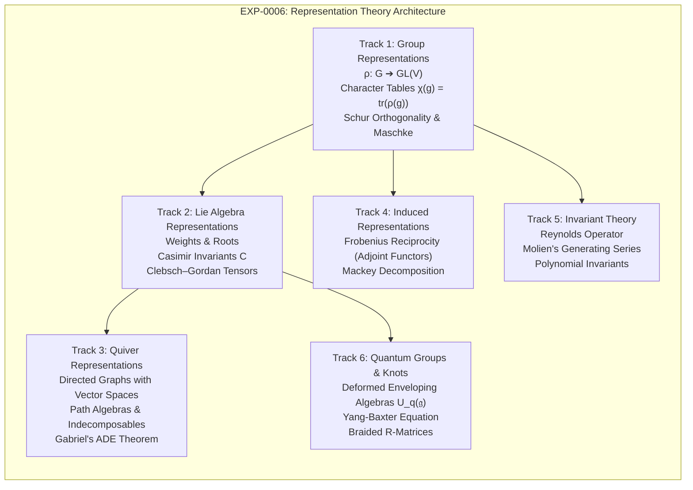

# EXP-0006: Representation Theory, Invariant Theory & Quantum Symmetries

| Field           | Value                                                              |
|:----------------|:-------------------------------------------------------------------|
| **EXP**         | 0006                                                               |
| **Title**       | Representation Theory, Invariant Theory & Quantum Symmetries       |
| **Author**      | Eran Rivlis <eran@rivlis.info>, Antigravity                        |
| **Status**      | Concluded (Recommended for Phase 8)                                |
| **Type**        | Architectural & Research Exploration                               |
| **Created**     | 2026-10-28                                                         |
| **Updated**     | 2026-10-28                                                         |
| **Related EPs** | `EP-0210`, `EP-0211`, `EP-0212`, `EP-0213`, `EP-0214`, `EP-0215`   |

---

## 1. Abstract & Context

Following the completion of Phase 7's categorical foundations, quantum algebras, and duality frameworks, this exploration investigates the foundational architecture for **Phase 8: Representation Theory, Invariant Theory & Quantum Groups**.

Representation theory is the study of abstract algebraic structures by realizing their elements as **concrete linear transformations (matrices) on vector spaces**:
$$\rho : G \longrightarrow \mathrm{GL}(V) \quad \text{or} \quad \rho : \mathfrak{g} \longrightarrow \mathfrak{gl}(V)$$

While an abstract group or Lie algebra defines symmetries through multiplication tables and commutation brackets, its representations determine **what states and objects can exist within that symmetric universe**—from quantum particle spins ($SU(2)$ / $SO(3)$) and crystallographic space groups to graph quiver states and polynomial invariants.

This exploration establishes the mathematical, architectural, and algorithmic framework for integrating representation theory into AlgebraX while strictly respecting the **zero-bloat sparse carrier constraint**.

---

## 2. Exploration & Options Analysis

The exploration investigates six interconnected mathematical tracks:

---

### Track 1: Finite & Compact Group Representations and Character Theory

For any finite group $G$ and representation $\rho: G \to \mathrm{GL}(V)$ over $\mathbb{C}$:
1. **Maschke's Theorem**: Every representation over a field of characteristic zero is completely reducible into a direct sum of irreducible representations (irreps):
   $$V \cong \bigoplus_{i=1}^k m_i V_i$$
2. **Character Theory**: The character $\chi_\rho(g) = \operatorname{tr}(\rho(g))$ is a class function (constant on conjugacy classes $C_j$).
3. **Schur's Orthogonality Relations**:
   $$\langle \chi_i, \chi_j \rangle = \frac{1}{|G|} \sum_{g \in G} \chi_i(g) \overline{\chi_j(g)} = \delta_{ij}$$
   - The **Character Table** is an orthogonal matrix!
   - Irreducibility is tested by $\langle \chi, \chi \rangle = 1$.
   - Multiplicities are computed via $m_i = \langle \chi, \chi_i \rangle$.
4. **Computational Representation in AlgebraX**:
   Characters are dictionary vectors mapping conjugacy class keys to complex/real floats. The character table is an orthonormal matrix evaluated using sparse inner products.

---

### Track 2: Lie Algebra Representations, Highest Weights & Clebsch–Gordan Coefficients

Building on AlgebraX's existing root systems (`algebrax.lie`, `EP-0164`):
1. **Highest Weight Classification**: Irreducible finite-dimensional representations of complex semisimple Lie algebras are uniquely classified by dominant integral weights $\Lambda$.
2. **Weight Spaces**: $V = \bigoplus_{\mu} V_\mu$ where $H \cdot v = \mu(H) v$ for Cartan subalgebra $H$.
3. **Clebsch–Gordan Coefficients**:
   When combining quantum systems (e.g., adding two angular momenta $j_1 \otimes j_2$):
   $$V_{\lambda_1} \otimes V_{\lambda_2} \cong \bigoplus_\mu c_{\lambda_1 \lambda_2}^\mu V_\mu$$
   The coupling coefficients $c_{\lambda_1 \lambda_2}^\mu$ are represented as **sparse 3-tensors** in `algebrax.tensor`.
4. **The Casimir Invariant**:
   The quadratic Casimir operator $C = \sum X_i X^i$ in the universal enveloping algebra $U(\mathfrak{g})$ commutes with all generators ($[C, X] = 0$), acting as a pure scalar on irreps by Schur's lemma:
   $$C|_{V_\lambda} = \langle \lambda, \lambda + 2\rho \rangle \mathbf{I}$$

---

### Track 3: Quiver Representations & Gabriel’s Theorem

A **quiver** $Q = (V_Q, E_Q)$ is a directed graph:
- A representation assigns a vector space $V_i$ to each node $i$, and a linear transformation $M_e: V_u \to V_v$ to each directed edge $e = (u, v)$.
- **Deep Structural Identity**: A quiver representation is literally a **Cellular Sheaf ([EP-0202](file:///C:/dev/erivlis/algebrax/docs/proposals/EP-0202-functorial-sheaves-and-categorical-dec.md))** on a directed 1-complex!
- **Gabriel's Theorem (1972)**: A quiver has a finite number of indecomposable representations (up to isomorphism) if and only if its underlying undirected graph is a **simply-laced ADE Dynkin diagram**:
  $$A_n, \quad D_n, \quad E_6, \quad E_7, \quad E_8$$
  The indecomposable representations correspond in 1-to-1 bijection with the **positive roots** of the Lie algebra!

---

### Track 4: Induced Representations & Frobenius Reciprocity

Given a subgroup $H \le G$ and a representation $V$ of $H$:
1. **Induction**: Constructs a representation $\operatorname{Ind}_H^G(V)$ of $G$ with dimension $[G : H] \dim V$.
2. **Frobenius Reciprocity (Adjunction)**:
   $$\operatorname{Hom}_G(\operatorname{Ind}_H^G(V), W) \cong \operatorname{Hom}_H(V, \operatorname{Res}_H^G(W))$$
   In categorical language: Induction $\operatorname{Ind}_H^G$ is the **left adjoint** to Restriction $\operatorname{Res}_H^G$!

---

### Track 5: Invariant Theory & Molien Series

Invariant theory studies polynomial functions $f(x_1, \dots, x_n)$ that remain unchanged under a linear group action $f(g \cdot x) = f(x)$:
1. **Reynolds Operator**: The projection onto invariants:
   $$\mathcal{R}(f) = \frac{1}{|G|} \sum_{g \in G} g \cdot f$$
2. **Molien's Formula**: The Hilbert series of the invariant ring $K[V]^G$ is given by an integral/sum of inverse determinants:
   $$\Phi(t) = \sum_{d=0}^\infty \dim(K[V]_d^G) t^d = \frac{1}{|G|} \sum_{g \in G} \frac{1}{\det(\mathbf{I} - t \rho(g))}$$
   This allows counting how many independent invariants exist at degree $d$ using matrix determinants!

---

### Track 6: Quantum Groups & The Yang–Baxter Equation

1. **Drinfeld–Jimbo Quantum Groups $U_q(\mathfrak{g})$**:
   $q$-deformations of universal enveloping algebras into non-cocommutative Hopf algebras (`EP-0206`).
2. **The Yang–Baxter Equation**:
   $$R_{12} R_{13} R_{23} = R_{23} R_{13} R_{12}$$
   The universal $R$-matrix $R \in U_q \otimes U_q$ satisfies the braid relations, connecting representation theory directly to **knot invariants (Jones polynomial)** and solvable statistical lattice models.

---

## 3. Architectural Synthesis & Council Alignment

- **⚖️ Noether (Invariants & Conserved Symmetries)**:
  Emmy Noether's landmark 1915 paper on finite invariant fields (*Der Endlichkeitssatz der Invarianten endlicher Gruppen*) proved that the invariant ring $K[V]^G$ is always finitely generated. Noether's conservation laws in physics are representations of symmetry groups.
- **⚡ Shannon (Zero Bloat & Sparse Matrix Mechanics)**:
  Every representation is stored as a dictionary mapping group elements to sparse block matrices. Character tables are 2D arrays or sparse dicts. Clebsch-Gordan coefficients are sparse 3-tensors.
- **🔬 Popper (Falsifiability & Strict Algebraic Invariants)**:
  Rigid, testable invariants:
  1. Character orthonormality: $\frac{1}{|G|} \sum \chi_i(g) \overline{\chi_j(g)} = \delta_{ij}$.
  2. Dimension sum: $\sum d_i^2 = |G|$.
  3. Molien series coefficient matching.
  4. Yang-Baxter matrix equation verification.
- **🧩 Russell (Taxonomy & Categorical Adjunction)**:
  Positions representations as functorial actions $\mathbf{B}G \to \mathbf{Vect}$. Identifies Frobenius reciprocity as a categorical adjunction $\operatorname{Ind} \dashv \operatorname{Res}$.
- **💡 Feynman (Freshman Test & Intuitive Demystification)**:
  *"A group is a list of rotational symmetry moves. A representation is the set of matrices that tells you what happens to an electron's spin when you make those moves."*

---

## 4. The Verdict

**Verdict**: **STRONGLY RECOMMENDED FOR FORMAL ADOPTION AS PHASE 8**.

Representation Theory is the natural climax of the algebraic architecture established in Phases 1 through 7, uniting:
- `algebrax.group` (Finite and permutation groups)
- `algebrax.lie` (Roots, weights, and Chevalley bases)
- `algebrax.sheaf` (Quiver representations as directed sheaves)
- `algebrax.algebra` (Algebras, Coalgebras, and Hopf algebras)

---

## 5. Potential Roadmapped Proposals (Phase 8 Track)

This exploration outlines the 6-proposal track for **Phase 8: Representation Theory, Invariant Theory & Quantum Groups**:

1. **`EP-0210: Group Representations, Character Tables & Schur's Lemma`**:
   - `Representation[G, V]` protocol.
   - Character computation $\chi(g) = \operatorname{tr}(\rho(g))$ and class function inner products.
   - Orthonormal character tables, irreducibility testing, and multiplicity decomposition.
2. **`EP-0211: Lie Algebra Representations, Weights & Clebsch–Gordan Tensors`**:
   - Weight space decomposition $V = \bigoplus_\mu V_\mu$.
   - Quadratic Casimir operator $C = \sum X_i X^i$ and eigenvalue calculation.
   - Sparse Clebsch-Gordan 3-tensor coupling coefficients for $\mathfrak{sl}_2$ and $\mathfrak{so}_3$.
3. **`EP-0212: Quiver Representations, Path Algebras & Gabriel's ADE Theorem`**:
   - Quiver representation protocol on directed graphs.
   - Path algebra constructor.
   - Verification of Gabriel's theorem: classifying indecomposables over ADE Dynkin quivers.
4. **`EP-0213: Induced Representations, Mackey Theory & Frobenius Reciprocity`**:
   - Subgroup representation induction $\operatorname{Ind}_H^G(V)$.
   - Adjunction verification: $\operatorname{Hom}_G(\operatorname{Ind} V, W) \cong \operatorname{Hom}_H(V, \operatorname{Res} W)$.
   - Mackey decomposition formula for double cosets.
5. **`EP-0214: Invariant Theory, Molien Series & Casimir Polynomials`**:
   - Reynolds projection operator $\mathcal{R}(f) = \frac{1}{|G|} \sum g \cdot f$.
   - Molien series generating function $\Phi(t) = \frac{1}{|G|} \sum \det(\mathbf{I} - t \rho(g))^{-1}$.
   - Primary and secondary polynomial invariants computation.
6. **`EP-0215: Quantum Groups, Yang–Baxter Equation & Braided Categories`**:
   - $q$-deformed universal enveloping algebra $U_q(\mathfrak{sl}_2)$.
   - Universal $R$-matrix satisfying the quantum Yang–Baxter equation.
   - Knot invariant computation (Jones polynomial) via quantum traces.

---

## 6. Annotated Bibliography & Linked Research Literature

1. **Jean-Pierre Serre (1977)**: *Linear Representations of Finite Groups*, Graduate Texts in Mathematics, Springer.
   - Foundational reference for character theory, induced representations, and Artin's theorem.
2. **William Fulton & Joe Harris (1991)**: *Representation Theory: A First Course*, Springer GTM 129.
   - Comprehensive treatment of Lie algebra representations, Young tableaux, and Schur-Weyl duality.
3. **Brian C. Hall (2015)**: *Lie Groups, Lie Algebras, and Representations: An Elementary Introduction*, Springer.
   - Clear, computationally minded treatment of matrix Lie groups, roots, weights, and the Baker-Campbell-Hausdorff formula.
4. **Peter Gabriel (1972)**: *Unzerlegbare Darstellungen I*, Manuscripta Mathematica, 6: 71–103.
   - The landmark paper proving that quivers with finite representation type are precisely the ADE Dynkin graphs.
5. **Christian Kassel (1995)**: *Quantum Groups*, Graduate Texts in Mathematics 155, Springer.
   - Canonical text on braided tensor categories, Hopf algebras, the Yang-Baxter equation, and knot invariants.
6. **Bernd Sturmfels (2008)**: *Algorithms in Invariant Theory*, Texts & Monographs in Symbolic Computation, Springer.
   - Algorithmic and computational methods for computing invariant rings, Molien series, and Gröbner bases for invariants.
