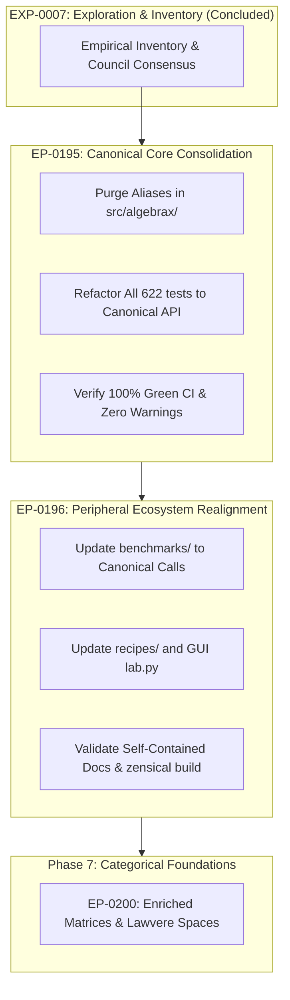

# EXP-0007: Canonical Surface Consolidation & Zero-Alias Purge

| Field           | Value                                                                                                                                                |
|:----------------|:-----------------------------------------------------------------------------------------------------------------------------------------------------|
| **EXP**         | 0007                                                                                                                                                 |
| **Title**       | Canonical Surface Consolidation & Zero-Alias Purge                                                                                                   |
| **Author**      | Eran Rivlis, Antigravity AI, Grand Council                                                                                                           |
| **Status**      | Concluded                                                                                                                                            |
| **Type**        | Architectural & Research Exploration                                                                                                                 |
| **Created**     | 2026-11-04                                                                                                                                           |
| **Updated**     | 2026-11-04                                                                                                                                           |
| **Related EPs** | [EP-0195](../../docs/proposals/EP-0195-canonical-core-consolidation.md), [EP-0196](../../docs/proposals/EP-0196-peripheral-ecosystem-realignment.md) |

---

## 1. Abstract & Context

### 1.1 The Problem Statement

Across Phases 1 through 6 of the `algebrax` expansion roadmap, the framework underwent rapid mathematical
evolution—advancing from a sparse matrix and semiring library to a fully realized, Lean 4 Mathlib-aligned deductive
algebraic hierarchy (EP-0190 through EP-0194).

During these rapid promotions, various backward-compatibility aliases, re-export shims, and legacy facades were
introduced to prevent transient test breakage. Examples include:

- Promoting `CliffordSemiring`, `DualNumberSemiring`, and `PolynomialSemiring` to multi-protocol structures
  (`CliffordAlgebra`, `DualNumberAlgebra`, `PolynomialAlgebra`), while leaving the old `*Semiring` and `*Ring` names
  pointing to them.
- Introducing Mathlib-aligned protocol names (`CommGroup`, `CommMonoid`, `CommRing`), while retaining English aliases
  (`AbelianGroup`, `CommutativeRing`, `CommutativeMonoid`).
- Maintaining root-level facades like `algebrax.homology` (re-exporting from `algebrax.topology`) and duplicate CLI
  scripts (`algebrax/verify.py` alongside `algebrax/verification.py` and `algebrax/__main__.py`).
- Maintaining shorthand aliases like `lu = lu_decompose` in `algebrax.matrix.decompose`.

### 1.2 The Architectural Question

Before embarking on **Phase 7 (Categorical Foundations, Morphisms & Duality)**, we must ask:
> *Does maintaining these backward-compatibility aliases actually serve the project, or does it create confusing
cognitive drag and technical sediment?*

Because `algebrax` is pre-v1.0 with no external legacy consumer base, compatibility aliases do not protect users; they
merely mask incomplete refactoring across tests, recipes, and benchmarks, while diluting the mathematical precision of
the public API.

---

## 2. Empirical Inventory of Aliases & Technical Sediment

An automated AST and regex census across the entire codebase revealed **14 major alias clusters** distributed across the
engine, verification suite, benchmarks, and recipes:

### 2.1 Empirical Occurrence Census

| Category                  | Alias / Shim Name             | Canonical Replacement             | Hits in `src/` | Hits in `tests/` | Hits in `recipes/` | Hits in `benchmarks/` |
|:--------------------------|:------------------------------|:----------------------------------|:--------------:|:----------------:|:------------------:|:---------------------:|
| **Domain Algebras**       | `CliffordSemiring`            | `CliffordAlgebra`                 |       13       |        10        |         12         |           0           |
|                           | `GeneralizedCliffordSemiring` | `GeneralizedCliffordAlgebra`      |       9        |        4         |         0          |           0           |
|                           | `QuantumCliffordSemiring`     | `QuantumCliffordAlgebra`          |       9        |        4         |         0          |           0           |
|                           | `DualNumberSemiring`          | `DualNumberAlgebra`               |       15       |        9         |         0          |           0           |
|                           | `DualNumberRing`              | `DualNumberAlgebra`               |       10       |        2         |         0          |           0           |
|                           | `PolynomialSemiring`          | `PolynomialAlgebra`               |       14       |        13        |         0          |           0           |
|                           | `PolynomialRing`              | `PolynomialAlgebra`               |       10       |        2         |         0          |           0           |
| **Hierarchy Protocols**   | `AbelianGroup`                | `CommGroup`                       |       5        |        4         |         0          |           0           |
|                           | `CommutativeGroup`            | `CommGroup`                       |       0        |        0         |         0          |           0           |
|                           | `CommutativeMonoid`           | `CommMonoid`                      |       3        |        2         |         0          |           0           |
|                           | `AbelianRing`                 | `CommRing`                        |       4        |        0         |         0          |           0           |
|                           | `CommutativeRing`             | `CommRing`                        |       4        |        4         |         0          |           0           |
|                           | `HasSMul`                     | `HasScale`                        |       3        |        2         |         0          |           0           |
| **Semiring Catalog**      | `BivariateCovarianceSemiring` | `BivariateVarianceSemiring`       |       7        |        6         |         0          |           0           |
| **Matrix Decompositions** | `lu`                          | `lu_decompose`                    |       1        |        6         |         0          |           1           |
| **Module Facades**        | `algebrax.homology`           | `algebrax.topology`               |       1        |        15        |         4          |           2           |
| **CLI Redundancy**        | `algebrax.verify`             | `algebrax.verification` / `ax -m` |       2        |        6         |         0          |           0           |

### 2.2 Analysis of Specific Findings

1. **Dual Number & Polynomial Triplications**:
   `DualNumberAlgebra` is currently exported under three names (`DualNumberAlgebra`, `DualNumberRing`,
   `DualNumberSemiring`). The same applies to `PolynomialAlgebra`. This forces developers and readers to wonder whether
   `DualNumberSemiring` is a restricted sub-class, when in fact it is an identical pointer.
2. **Clifford Semiring Sediment**:
   `CliffordSemiring` is heavily used across 12 recipe notebooks and 10 test files, despite `CliffordAlgebra` being the
   unified mathematical object supporting multivectors, rotors, and matrix representations.
3. **`algebrax.homology` Facade**:
   `src/algebrax/homology.py` is a 92-line duplicate facade that merely imports from `algebrax.topology`. 15 test suites
   and 4 recipes still import from `algebrax.homology`, meaning our tests were largely not exercising the canonical
   `algebrax.topology` import paths directly.
4. **Semiring Catalog Invariant**:
   `Semiring.catalog()` lists 34 semirings, but `BivariateVarianceSemiring` is registered twice (under both
   `'BivariateVariance'` and `'BivariateCovariance'`).

---

## 3. Architectural Synthesis & Council Deliberation

The Grand Council evaluated the alias purge against [`PRINCIPLES.md`](file:///C:/dev/erivlis/algebrax/PRINCIPLES.md):

### 3.1 Bertrand Russell (Soundness, Rigor & Unique Designation)

> *"Every mathematical concept must have exactly one formal symbol. Having synonyms in an algebraic system creates false
distinctions in the mind and bloats the type lattice. If `CommRing` is our Lean 4 Mathlib standard, then `AbelianRing`
and `CommutativeRing` are syntactic noise that must be eliminated."*

### 3.2 Claude Shannon (Information Parsimony & Minimal Entropy)

> *"Aliases are redundant bits with zero mutual information. They increase autocomplete latency, double the search space
in docstrings, and waste cognitive bandwidth. Purging them compresses the API surface to its optimal entropy."*

### 3.3 Richard Feynman (Honesty, Transparency & Didactic Clarity)

> *"When students see both `PolynomialRing` and `PolynomialAlgebra`, they ask: 'Which one should I use? Are the
algorithms different?' Telling them 'they are aliases' is an apology for lazy refactoring. Clean it up so the code
speaks the exact truth."*

### 3.4 Karl Popper (Falsifiability & Direct Verification)

> *"Tests that invoke legacy aliases do not test the canonical surface under stress. A test suite must exercise the
exact public API contracts that modern users are expected to consume."*

### 3.5 The Golem (Defensive Correctness & Pre-Release Timing)

> *"Breaking changes in production are dangerous; carrying technical debt across architectural phase boundaries is
fatal. We are pre-v1.0. This is the only window in the lifecycle of `algebrax` where a zero-debt purge can be executed
swiftly, cleanly, and completely."*

---

## 4. The Verdict / Actionable Design

### 4.1 Verdict

**Unanimous Council Decision**: Execute a complete, zero-alias consolidation before beginning Phase 7. All historical
aliases, shims, and duplicate facades will be removed. Every concept in `algebrax` will have exactly **one canonical
name** and **one canonical module location**.

### 4.2 Two-EP Phased Strategy

To maintain continuous CI green builds and avoid breaking the test suite during refactoring, the work is partitioned
into two focused Enhancement Proposals:

#### **EP-0195: Canonical Core Consolidation & Verification Suite Alignment**

- **Scope**: `src/algebrax/` and `tests/`.
- **Engine Actions**:
    1. Remove `CliffordSemiring`, `GeneralizedCliffordSemiring`, `QuantumCliffordSemiring` aliases $\to$ retain
       canonical `CliffordAlgebra`, `GeneralizedCliffordAlgebra`, `QuantumCliffordAlgebra`.
    2. Remove `DualNumberRing`, `DualNumberSemiring` $\to$ retain canonical `DualNumberAlgebra`.
    3. Remove `PolynomialRing`, `PolynomialSemiring` $\to$ retain canonical `PolynomialAlgebra`.
    4. Remove `AbelianGroup`, `CommutativeMonoid`, `AbelianRing`, `CommutativeRing` $\to$ retain canonical `CommGroup`,
       `CommMonoid`, `CommRing`.
    5. Remove `HasSMul` $\to$ retain canonical `HasScale`.
    6. Remove `BivariateCovarianceSemiring` alias $\to$ retain canonical `BivariateVarianceSemiring`.
    7. Remove `lu` alias in `algebrax.matrix.decompose` $\to$ retain canonical `lu_decompose`.
    8. Delete `src/algebrax/homology.py` legacy facade $\to$ update all imports to `algebrax.topology`.
    9. Consolidate `src/algebrax/verify.py` into `algebrax/verification.py` and `algebrax/__main__.py`.
- **Test Actions**:
    - Update all 622 tests across `tests/algebrax/` and `tests/verifications/` to use canonical names.
    - Verify that `uv run pytest` passes 100% with zero alias deprecation warnings.

#### **EP-0196: Peripheral Ecosystem Realignment (Benchmarks, Recipes, GUI Lab & User Guides)**

- **Scope**: `benchmarks/`, `recipes/`, `docs/`.
- **Benchmarks**: Update `benchmarks/test_linalg_benchmarks.py` and `benchmarks/test_benchmarks.py` to canonical
  `lu_decompose` and `algebrax.topology`.
- **Recipes**: Update all `.py` and `.ipynb` recipes (including `clifford_rotor_kinematics`, `topological_*`) to
  canonical `CliffordAlgebra` and `algebrax.topology`.
- **Docs**: Run `uv run zensical build --clean` to ensure all user documentation aligns with the canonical, alias-free
  API.

---

## 5. Related Enhancement Proposals & Artifacts

- **[EP-0099: Master Expansion Roadmap](../../docs/proposals/EP-0099-expansion-roadmap.md)**: Updated to include EP-0195
  and EP-0196 concluding Phase 6.
-
**[EP-0190: Granular Algebraic Hierarchy](../../docs/proposals/EP-0190-granular-algebraic-hierarchy-magmas-monoids-groups.md)**
-
**[EP-0191: Rings, Fields, Modules & Exact Solvers](../../docs/proposals/EP-0191-rings-fields-modules-and-exact-solvers.md)**
-
**[EP-0192: Unifying Domain Objects with the Algebraic Hierarchy](../../docs/proposals/EP-0192-unifying-domain-objects-with-algebraic-hierarchy.md)**
-
**[EP-0194: Atomic Algebraic Mixins & Protocol Composition](../../docs/proposals/EP-0194-atomic-algebraic-mixins-and-protocol-composition.md)**
-
**[EP-0195: Canonical Core Consolidation & Verification Suite Alignment](../../docs/proposals/EP-0195-canonical-core-consolidation.md)**
- **[EP-0196: Peripheral Ecosystem Realignment](../../docs/proposals/EP-0196-peripheral-ecosystem-realignment.md)**
